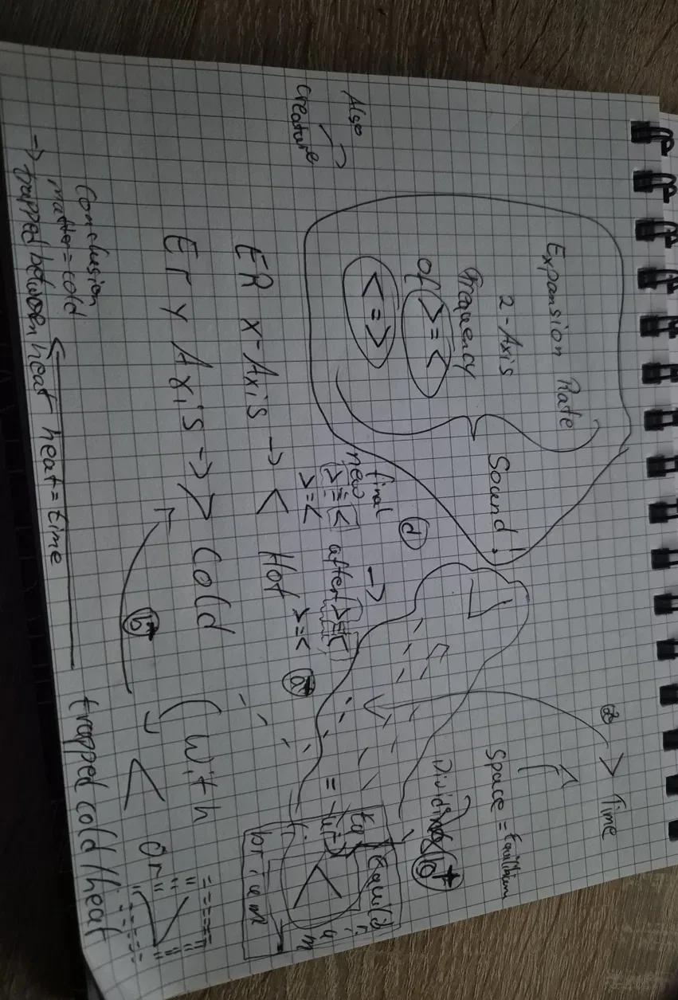
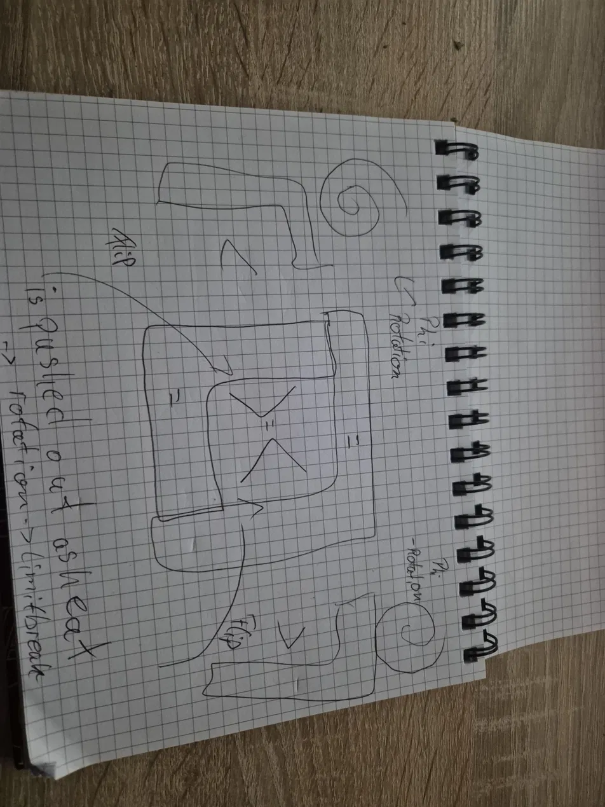

## WhoIsMe
(I'm Marcello alias Marc. going by Marcello (LogusCello). I'm just some Guy that wondered why the Moons Gravity is so close to phi and it somehow derailed into a year long Theorem, which essentially lead to Nothing, or does it?  As I can't tell for sure and I won't pretend I do, at the end of the day I'm just some guy that looked at the moon asked a question then started an (obsessive 10h+ a day science arc over the span of a year) going from "Gedankenexperiment" to another for hours a day, nothing to show, no one who cares, so I don't expect anyone to care now. I'm just sharing this so anyone can read this and who knows maybe Nothing is what gets anyone a bright idea that actually leads to Something, maybe even Everything.

**DISCLAIMER:**, everything marked as PROVEN, is only proven as far as i couldn't see the issue with it, yet, if you have one please do tell, but fair warning I'm an autodidact learner and I'm missing the jargon so my explanations may be messy, so take all with a grain of salt, but if you happen to find anything you agree on please feel free to share, as each could potentially link to the answer of a future question, or someone elses.

**Note:**

This is not yet complete, this has been a work effort of one year (present earth time) i have only recently started to fix things up into a presentable way, so I apologize for how messy this repo will look its more of a scrapyard of ideas if anything so maybe some of these scraps might help anyone out so feel free to use, if you liked the idea please do consider to credit me and if you find something that can truly be considered proven please do tell, as I don't have a formal review besides Claude Opus 5.5, Chatgpt Astra and it would be nice to know what holds and what not from a different perspective.

<h3 align="center"> DISC0VER THE UNKN0WN F0R IT MIGHT BE THE SAME two things (0) which are both equally unknown until the 0BSERVATION concludes.)

# In my words

These are the ideas as I first wrote them, unedited, typos and all. [THEOREM.md](THEOREM.md) is the careful version.

## The foundation
> "Nothing is not Nothing, and Noting is not Everything, Nothing is Something which is neither Nothing nor Everything but it might also be both at the same time."

## The pathway of 1
> "if something moves at max speed it appears still if that being still is the illusion of matter from the theorem we are looking at gaps as they can not perfectly connect to each other due to nothing being around everything as part of the theorem so something size shrinking by exactly 1 can technically endlessly parse through the matter and "fall" instantly to the computed previous point while the same would count for bigger so there is a pathway of 1 through everything but as everything moves it leads to that pathway mismatching by one"

## Phi rotation and the pendulum +2 (2026-10-15)
> "phi is the roation, no limit is broken as they are only > hot and < cold so only one ever swaps so if the first particle there changes every other reaction happens it only takes heat and cold as it pressures outwards as it cant mix. the "=" between them is just this process as +2 happening at the same time like two pendel balls hitting each other. so the +2 is shared by each 0.1111 or more specifically each +1-1,2 as its the final rotation results als all -1 and all +1 as 0.11111111111111 and -0.11111111... add up as 2 as that is the computational result leading to 0.2222222 and 0.0000000 […] the largest loop is also the three steps as foundation"

## The box (2026-10-15)
> "its +L1-L1 we add that and remove that in two frames instead of +L1/-L1 the same frame but we jumped one more time due to division and yes the by size count is intended. […] phi i used all the time as that is essentially the equilibrium of the pressure so what goes out two way as computated 2 so the result can increase and grow as "division" of what was inside the previous equilibrium so it is all just based on what rotation matches everything else is the same its either hot or cold at the point where the equilibrum starts so it can only connect to the opposite "nested rotation" […] the core only does >< and <> as the "=" is around each so once any matches the rotation they combine in that unique id if they meet its same connector on the second layer it cant connect only to the inverse so that inverse sticks and the equilibrium forms around both […] so the equilibrium written in 1D becomes >=< and <=> as the "=" equilibrium is around both =<=>= so the equilibrium shapes as "box" around the angled ">""<" of which each owns half the box and they break the box once they "<>" flip so the result breaks the box then shapes it again as the same box slowly closing in to pi for everything growth as you start with a dot form the boxes then the inside then the result all in one paint stroke as the more you do that the more boxes you get that split (divide) so the result forms phi that then shifts each time while it exists between two layers and is pressed into pi as that is the furthermost of the geometry it can be as its essentially all of geometry condensed to pi. its still wonky and needs some more thought but that so far"

## The sketches
| Z-axis = sound | φ rotation and the flip |
|---|---|
|  |  |

- **Sketch 1:** `>` = time, space = `=`. ER x → `<` hot, ER y → `>` cold, and ER z = the frequency of `>=<` ↔ `<=>` = **sound**. Matter = trapped cold, trapped heat = time.
- **Sketch 2:** a `<` hook on a +φ rotation and a `>` hook on a −φ rotation flip inward around a `>=<` held in `=` boxes. What doesn't fit is pushed out as heat → rotation → limit break.
